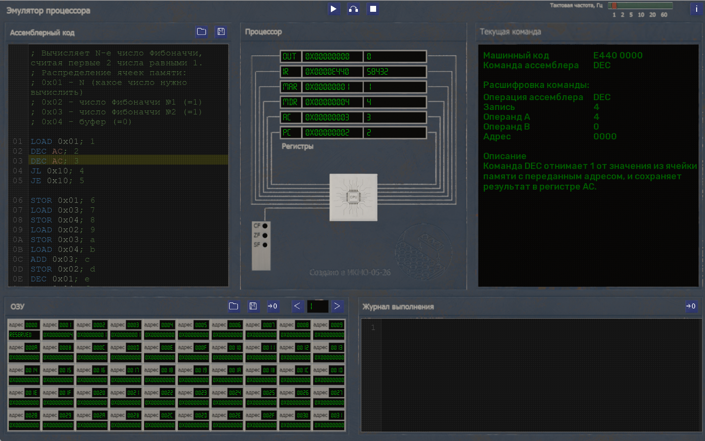
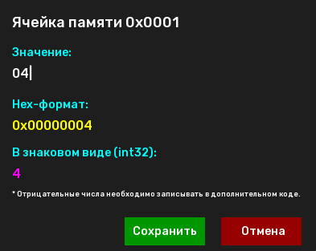

# Инструкция по использованию
Это инструкция по использованию [учебного процессора](../Readme.md).

## Общий вид программы

Окно программы можно разделить на 5 частей:

### Окно редактирования ассемблерного кода

Поддерживает разметку текста с помощью цветовой схемы по аналогии с VS Code, что сильно упрощает написание кода и позволяет выявить часть ошибок до запуска программы:
- синий цвет - команды ассемблера;
- оранжевый цвет - регистры;
- салатовый цвет - адреса;
- зеленый цвет - комментарии.

Процессором используется кастомный ассемблерный код, документацию к которому можно найти [здесь](AssemblerCode.md).

При выполнении программы инструкция, которая будет выполнена на следующий такт процессора, будет подсвечиваться желтым цветом.

Пользователь может загрузить или сохранить уже имеющийся код ассемблера через кнопки в правой верхней части окна. Код сохраняется как обычный текст в кастомном формате .asmb - расширение используется только для идентификации файлов кода.

### Окно регистров

В нем показывается текущее состояние регистров (OUT, IR, MAR, MDR, AC, PC) и флагов процессора.

Для регистров указывается их название и их значение в шестнадцатеричном и знаковом десятичном форматах. Процессор оперирует 6 регистрами:
- OUT - регистр для вывода результата. Используется на усмотрение разработчика, например, для вывода итоговых результатов программы;
- IR - регистр инструкций. Содержит машинный код текущей исполняемой инструкции;
- MAR - регистр адреса памяти. Содержит адрес ячейки памяти, к которой обращается текущая инструкция. Разработчик может изменить значение MAR очередной инструкцией по своему усмотрению в пределах от 0 до 65 535 (0xFFFF) командой STOR MAR, реализовав таким образом аналог обращения к элементу массивов по индексу;
- MDR - регистр значения памяти. Содержит значение ячейки памяти с адресом из регистра MAR. Разработчику не следует изменять его значение, однако он может прочитать значение из него с помощью команды LOAD MDR;
- AC - аккумулятор. Является буфером для вычислений и может использоваться разработчиком по своему усмотрению;
- PC - счетчик. Содержит адрес следующей исполняемой инструкции. Как правило, изменяется с помощью условных и безусловных переходов, хотя разработчик может изменить его напрямую.

Флаги показываются в виде мини-панели и включают в себя 3 флага:
- CF - флаг переноса (carry flag). Поднимается, если последняя арифметическая операция сложения/вычитания вызвала перенос/заем из/для старшего разряда;
- ZF - флаг нуля (zero flag). Поднимается, если в результате выполнения последней арифметической операции сложения/вычитания получился 0;
- SF - флаг знака (sign flag). Поднимается, если в результате выполнения последней арифметической операции сложения/вычитания получилось отрицательное число.

Поднятые флаги отображаются как зеленые светящиеся точки напротив соответствующей подписи.

Окно регистров и флагов обновляется по мере выполнения программы, что позволяет разработчику следить за изменениями значений в реальном времени.

### Окно информации о текущей команде

В нем показывается информация о текущей команде. Доступно только если программа запущена в режиме выполнения по шагам.

В сведения о команде входят:
- машинный код команды (в hex-формате 8765 4321, где цифра обозначет порядковый номер разряда);
- название команды ассемблера;
- расшифровка команды:
- - операция ассемблера (соответствует разряду 8 из машинного кода);
- - место, куда проводится запись (соответствует разряду 7 из машинного кода);
- - операнды А и B (соответствует разрядам 6 и 5 из машинного кода соответственно);
- - адрес команды (записан в разрядах 4321 машинного кода);
- описание команды.

### Модуль ОЗУ

В нем показывается текущее состояние ячеек памяти ОЗУ. ОЗУ имеет 65 536 ячеек памяти, каждая из которых хранит по 4 байта информации (32 бита), что позволяет хранить в памяти целые числа от -2 147 483 648 до 2 147 483 647 (для чисел со знаком) или от 0 до 4 294 967 295 (для беззнаковых чисел). Хранение чисел с плавающей запятой, а также чисел с большим количеством разрядов нативно не поддерживается и должно быть реализовано разработичком при необходимости самостоятельно.

Модуль ОЗУ отображает ячейки памяти страницами по 50 штук. Номер страницы можно задать с помощью кнопок в правом верхнем углу. Для каждой ячейки памяти записывается ее адрес и текущее значение.

Значение ячейки памяти можно изменить в любой момент. Для этого необходимо навести мышь на текст значения (он подсветится желтым) и нажать ЛКМ - тогда откроется окно редактирования значения ячейки памяти.

В этом окне будет показано значение ячейки в трех форматах: беззнаковом десятичном (белое, его можно редактировать), шестнадцатеричном (желтое) и знаковом десятичном (розовое).

Ячейка 0х0 является зарезервированной и всегда содержит 0; изменить ее программно или через окно редактирования нельзя. Разработчик может использовать эту ячейку (LOAD 0x0) или команду CLS для быстрого установления значения AC равным 0.

Текущее состояние памяти можно выгружать в дамп и загружать из него. Дамп создается в виде бинарного файла и содержит сигнатуру файла для определения, что файл был создан для этой программы, и значения ячеек памяти по порядку. Размер бинарного файла фиксирован и равен 256 КБ.

Также память можно занулить с помощью кнопки зануления. При ее нажатии значение каждой ячейки памяти становится равным 0.

### Журнал выполнения

В этом окне отображаются логи системы: загрузка и сохранение файлов, загрузка/сохранение/зануление памяти, результаты запуска программ. Здесь же выводятся сообщения об ошибках в синтаксисе запускаемых программ. Журнал можно очистить, нажав на кнопку очистки.

### Верхняя панель

На верхней панели есть три кнопки для управления программой:
- запуск кода последовательно. В этом случае программа сама выполняет весь ассемблерный код с заданной тактовой частотой;
- запуск кода по шагам. В этом случае программа эмулирует только один такт процессора, что дает разработчику инструмент для пошаговой проверки логики кода;
- остановка программы.

В правом верхнем углу есть переключатель тактовой частоты процессора, позволяющий установить значения 1, 2, 5, 10, 20 и 60 Гц.